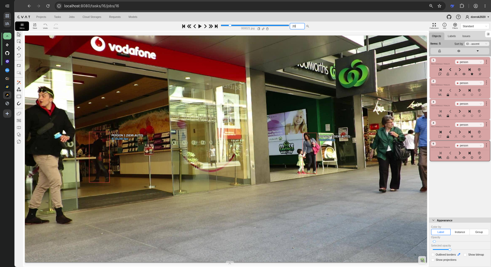
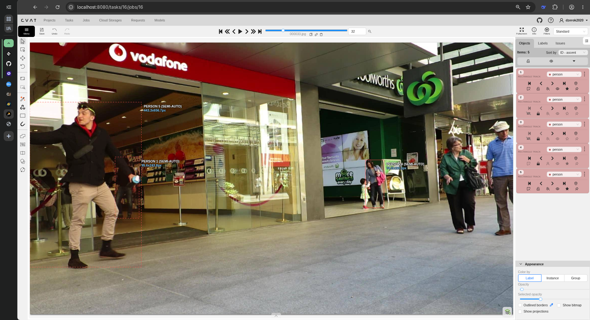
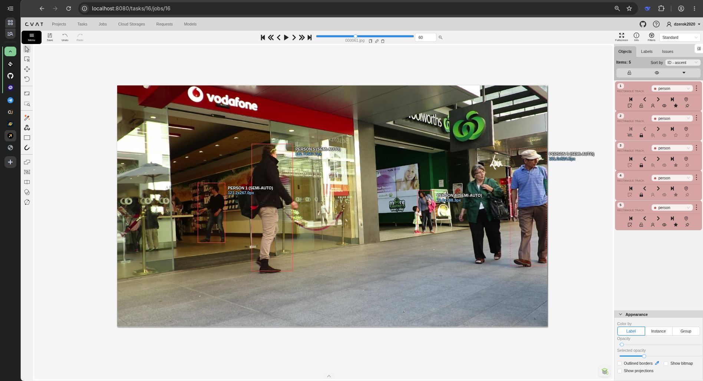

# Báo cáo cá nhân — VuDuyKhanh-2A202603142

Đổi tên file theo quy tắc `MSSV_HoTen.md`. Ví dụ: `20241234_NguyenVanAn.md`.

Đoạn video: MOT17-09, 150 frame (frame 1–150), nguồn MOTChallenge, giấy phép CC BY-NC-SA 3.0.

## 0. Thông tin học viên

- Họ tên: Vũ Duy Khanh
- MSSV: 2A202603142
- Mã đề (A/B/C): C
- Email: 26ai.khanhvd@vinuni.edu.vn
- Link repository: https://github.com/o0DzeroK0o/K5-L2-DAY05-VuDuyKhanh-2A202603142-MOTTracking.git
- Giờ bắt đầu: 16:30 13/11/2026
- Giờ kết thúc: 23:00 13/11/2026

## 1. Xem trước đoạn video (CP0)

Ghi **trước khi vẽ**, mỗi người một dòng.

| Mã | Frame xuất hiện | Frame cuối thấy được | Rẽ / dừng / đổi tốc độ ở frame | Bị che ở frame | Ghi chú |
|---|---|---|---|---|---|
| P1 | 0 | 149 | Khoảng 60–69 xoay người; 90–113 giảm dịch chuyển ngang, sau đó tiến gần camera | Che một phần 26–41, 44–54 và 98–112; khuất hẳn 42–43 theo bản xuất | Người áo đen, quần jeans trong cửa hàng Vodafone; cần phân biệt với P5 đi ngang phía trước. |
| P2 | 61 là mốc bắt đầu nhận diện/gán trong bản xuất | 149 | Khoảng 100–120 chậm lại theo phương ngang; 120–149 đổi tư thế và tiến gần camera | Bản xuất bật `occluded` ở 61–100, không có đoạn `outside` | Người mặc áo sáng màu có dải màu cam, quần tối trong cửa hàng; cửa kính, quầy và phản chiếu làm khó xác định toàn thân. |
| P3 | 0, mới thấy một phần ở mép phải; track bắt đầu muộn ở 40 | 149 | Đi từ phải vào và tiến gần camera; kích thước tăng rõ ở 90–149, không thấy dừng hẳn | Bản xuất bật `occluded` ở 40–66, không có đoạn `outside` | Người áo polo xanh lam, đội mũ sáng màu; cần phân biệt bị cắt bởi mép ảnh với bị vật khác che. |
| P4 | 0; track hiện tại bắt đầu ở 2 | Khoảng 104–105 còn nhận diện được một phần; sau đó bị che mạnh, dù track vẫn kéo đến 149 | 0–40 dịch chuyển chậm sang phải; khoảng 40–88 gần như đứng tại chỗ cạnh em bé | Bắt đầu bị người áo xanh lá phía trước che khoảng 89; sau đó còn bị P3 che, nhưng bản xuất chỉ bật `occluded` ở 89–105 | Người áo xám, mang túi hồng trước Woolworths; cần kiểm tra lại cờ từ 106, không coi box tồn tại là bằng chứng người vẫn nhìn thấy. |
| P5 | 0, một phần ở mép trái; track bắt đầu muộn ở 28 | 149, chỉ còn thấy một phần sau đoạn che | Khoảng 20–45 quay đầu, giang tay rồi tiếp tục sang phải; 45–110 đi ra xa nên box nhỏ dần | Bản xuất bật `occluded` ở 28–36, 109–119, 122–136 và 149; `outside` ở 120–121, 137–148 | Người áo khoác đen, khăn đỏ, quần kaki, túi đeo chéo; đi cắt trước P1 rồi khuất sau người phía trước. |

Các frame đều tính theo CVAT, từ 0 đến 149. P1–P5 được nhận diện theo bảng đề C và `src/lab_variants.json`, tương ứng ID gốc MOT17 là 1, 7, 20, 22, 23. Bảng trên được đối chiếu lại từ ảnh gốc và bản xuất; các đoạn ghi “bản xuất” mô tả cờ đang có, không khẳng định mọi cờ đều đúng. Frame tham chiếu trong bảng nhận diện không nhất thiết là frame đầu tiên người đó xuất hiện.

## 2. Keyframe và thời gian (CP1, CP4)

Số keyframe lấy từ kết quả `src/check_submission.py`.

| Mã | Số keyframe | Keyframe ở frame | Số frame có mặt | Keyframe / 100 frame | Thời gian (phút) | Chỗ khó |
|---|---|---|---|---|---|---|
| P1 | 66 | 0–35, 37, 44–48, 55–67, 69, 74, 79, 89, 98–99, 113, 120, 130, 140, 149 | 148 | 44,6 | Khoảng 55 (ước tính) | Ước lượng toàn thân khi P5 đi ngang; phân biệt che một phần với mất hẳn ở 42–43. |
| P2 | 89 | 61–149 | 89 | 100,0 | Khoảng 50 (ước tính) | Cửa kính, quầy và phản chiếu; khó giữ box ổn định khi mới xuất hiện và khi tiến gần camera. |
| P3 | 110 | 40–149 | 110 | 100,0 | Khoảng 60 (ước tính) | Người tiến gần camera, chiều cao box tăng từ khoảng 481 lên 948 pixel; cần bám đúng đỉnh mũ và chân. |
| P4 | 95 | 2–94, 99, 106 | 148 | 64,2 | Khoảng 45 (ước tính) | Người nhỏ ở hậu cảnh, đứng cạnh em bé rồi bị người phía trước che; box giữ nguyên từ 106 đến 149 cần kiểm tra lại. |
| P5 | 105 | 28–119, 122, 126–136, 149 | 108 | 97,2 | Khoảng 70 (ước tính) | Di chuyển ngang nhanh, quay người, kích thước giảm và hai lần khuất hẳn; khó ước lượng box toàn thân ở cuối đoạn. |
| **Tổng** | **465** | Hợp các danh sách ở trên, cộng theo từng người | **603** | **77,1** | **Khoảng 280 (ước tính)** | Tập trung khó khăn ở che khuất, mép ảnh và thay đổi kích thước. |

Keyframe / 100 frame của cả bài = tổng keyframe ÷ tổng số frame có mặt × 100 = **465 ÷ 603 × 100 ≈ 77,1 keyframe / 100 frame**.

Trong danh sách keyframe, `a–b` nghĩa là tất cả frame từ a đến b, tính cả hai đầu. “Số frame có mặt” ở bảng này là số box có `outside=0` trong bản xuất, đúng cách tính của script, không phải số frame nhìn thấy đã được xác nhận hoàn toàn bằng mắt. Script không cộng keyframe bật `outside` vào số keyframe này.

Ánh xạ đã đối chiếu bằng frame và tọa độ box: **P1 → XML 0 / MOT 1; P2 → XML 1 / MOT 5; P3 → XML 2 / MOT 4; P4 → XML 3 / MOT 2; P5 → XML 4 / MOT 3**. Không lấy thứ tự ID của `gt.txt` làm thứ tự P1–P5.

Thời gian từng người là **ước tính để tham khảo**, không phải số đo có nhật ký xác nhận. Tổng 280 phút chỉ ước tính cho việc gán và chỉnh 5 người; khoảng thời gian 16:30–23:00 ở mục 0 là 390 phút cho toàn buổi, có thể bao gồm chuẩn bị, nghỉ, review, xuất file và viết báo cáo.

Bạn đặt keyframe nhiều nhất ở người nào? Vì sao (người đó rẽ, dừng, lại gần camera hay bị che)?

P3 có nhiều keyframe nhất: **110 keyframe trên 110 frame có nhãn**. Người này đi từ mép phải vào và tiến gần camera, làm vị trí, chiều rộng và chiều cao box thay đổi rõ, nhất là đoạn 90–149. Đây là chỗ cần kiểm tra nội suy kỹ, nhưng đặt keyframe ở mọi frame vẫn quá dày; thay đổi kích thước không tự nó chứng minh rằng cần sửa từng frame. P2 cũng đạt mật độ 100,0 nhưng chỉ có 89 keyframe nên không phải người có số lượng lớn nhất. Bốn cảnh báo thuộc P2, P3, P4 và P5 phản ánh việc đặt keyframe chưa tiết kiệm; cần giữ các mốc thay đổi chuyển động/che khuất và bỏ những keyframe dư sau khi kiểm tra box nội suy.

## 3. Đoạn bị che (CP2)

Người bị che: `P1`

| Mốc | Frame |
|---|---:|
| Bắt đầu bị che một phần (bật `occluded`) | 26 |
| Mất hẳn (bật `outside`) | 42 |
| Hiện lại (tắt `outside`) | 44 |
| Thấy rõ trở lại (tắt `occluded`) | 55 |

- Thời gian khuất hẳn: **2** frame = **2/30 ≈ 0,067** giây.
- Quyết định: giữ cùng ID / tạo track mới.

  **Trả lời: Giữ cùng ID** — P1 vẫn là track 0 trong XML và ID 1 trong MOT trước và sau đoạn che; bật/tắt `outside` trên chính track đó.

- Lý do (trả lời 3 câu: khuất bao lâu so với 60 frame, ngoại hình có khớp, chỗ hiện lại có đúng hướng và tốc độ):

1. P1 khuất hẳn ở frame 42–43, chỉ 2 frame, nhỏ hơn nhiều so với ngưỡng 60 frame của lớp.
2. Khi hiện lại, áo đen, quần jeans, kính và dáng người khớp với P1 trước khi bị P5 che.
3. P1 hiện lại ở vị trí tiếp nối hướng dịch chuyển chậm sang phải trong cửa hàng, phù hợp với khoảng thời gian khuất rất ngắn, nên không có cơ sở tạo ID mới.

Ở 26–41 và 44–54, box vẫn bao toàn thân ước lượng và giữ `occluded=1`; ở 42–43, `outside=1` nên không có dòng MOT cho P1. Frame 44 là keyframe hiện lại, còn 55 là mốc tắt `occluded` trong bản xuất. Ba ảnh bên dưới tương ứng frame 20, 32 và 60: ảnh giữa minh họa **che một phần**, không phải hai frame khuất hẳn. Nguồn ảnh: MOT17, MOTChallenge (Milan et al., 2016).

Ảnh chụp màn hình:





## 4. Tự review ID (CP3)

Lượt 1 theo người (đi ngược từ frame 149 về 0 trên CVAT), lượt 2 theo cảnh (nhảy 10 frame). Ít nhất 3 dòng; không có lỗi thì ghi một dòng "đã kiểm hai lượt, không lỗi".

Loại lỗi dùng đúng một trong 7 mã: `id_switch`, `fragmentation`, `lost`, `merge`, `false_track`, `drift`, `flag`.

| Frame | Mã người | Loại lỗi | Mô tả một câu | Phát hiện ở lượt | Đã sửa? |
|---:|---|---|---|---|---|
| 106–149 | P4 | `flag` | Từ frame 106, bản xuất tắt `occluded` và giữ `outside=0` dù P4 tiếp tục bị người áo xanh lá rồi P3 che, có mốc không còn nhận diện được P4. | 1 — đối chiếu từng người và cờ | Chưa trong bản xuất; cần xác định lại từng mốc che một phần/mất hẳn và sửa cờ tương ứng. |
| 0–1 | P4 | `lost` | P4 đã thấy cạnh em bé ở frame 0–1 nhưng track chỉ bắt đầu ở frame 2 nên thiếu box đầu đoạn. | 2 — đối chiếu toàn cảnh đầu video | Chưa trong bản xuất; cần kéo dài cùng track về frame đầu thấy được. |
| 0–27 | P5 | `lost` | P5 đã xuất hiện từ mép trái và đi vào khung trước frame 28 nhưng chưa có box trong đoạn 0–27. | 2 — đối chiếu toàn cảnh, rồi kiểm các frame đầu | Chưa trong bản xuất; cần bổ sung phần đầu của chính track P5. |
| 0–39 | P3 | `lost` | P3 đã lộ một phần ở mép phải từ đầu video nhưng track chỉ bắt đầu ở frame 40. | 2 — đối chiếu toàn cảnh, rồi kiểm mép phải | Chưa trong bản xuất; cần bổ sung box cho phần người nhìn thấy trước frame 40. |

Các dòng trên là kết quả **đối chiếu lại ảnh gốc với hai file xuất hiện có**, không phải nhật ký khẳng định đã sửa lỗi trên CVAT. Cột “Đã sửa?” phản ánh đúng bản xuất đang dùng; việc điền báo cáo không làm thay đổi nhãn. Lượt theo người giúp kiểm tra tính liên tục và cờ qua từng frame; lượt toàn cảnh giúp phát hiện người có mặt nhưng thiếu box, nhất là trước frame bắt đầu track.

Tổng hợp số lỗi theo loại:

| `id_switch` | `fragmentation` | `lost` | `merge` | `false_track` | `drift` | `flag` |
|---:|---:|---:|---:|---:|---:|---:|
| 0 ghi nhận | 0 ghi nhận | 3 đoạn | 0 ghi nhận | 0 ghi nhận | 0 kết luận chắc chắn | 1 đoạn |

Tổng hợp đếm **4 trường hợp trong bảng**, không cộng từng frame thành một lỗi riêng và không phải kết quả chấm với ground truth. Cảnh báo keyframe dày thuộc mục 2, không tự động quy thành `drift` hay `id_switch`.

Lỗi nào chỉ lượt 2 (theo cảnh) mới thấy, lượt 1 (theo người) không thấy? Vì sao?

Các đoạn `lost` ở đầu video của P3, P4 và P5 là những lỗi nổi bật khi đối chiếu toàn cảnh: có người mục tiêu nhưng chưa có box tương ứng. Nếu lượt theo người chỉ bám phần track đã tồn tại, rất dễ coi frame đầu track là frame đầu người xuất hiện và bỏ qua phần trước đó. Lượt theo cảnh buộc đối chiếu tất cả người mục tiêu với tất cả box nên phát hiện được thiếu nhãn; sau đó cần tua từng frame để xác định ranh giới. Không có nhật ký review trước đây để khẳng định chúng từng bị bỏ sót ở lượt nào trên CVAT; các lượt trong bảng mô tả cách kiểm tra bản xuất hiện tại.

## 5. File xuất và kết quả tự kiểm (CP4)

| Kiểm tra | Kết quả |
|---|---|
| Tên file MOT 1.1 | `src/exports/VuDuyKhanh_mot.zip` — chứa `gt/gt.txt` và `gt/labels.txt`, không kèm ảnh. |
| Tên file CVAT for video 1.1 | `src/exports/VuDuyKhanh_cvat_video.zip` — chứa `annotations.xml`, không kèm ảnh. |
| Số track ID khác nhau trong `gt/gt.txt` (phải là 5) | **5 ID: 1, 2, 3, 4, 5**, tổng cộng **603 box**. |
| Frame `outside` không có dòng trong `gt.txt` (đúng / sai) | **Đúng.** P1/MOT ID 1 vắng ở CVAT 42–43, tương ứng MOT 43–44; P5/MOT ID 3 vắng ở CVAT 120–121 và 137–148, tương ứng MOT 121–122 và 138–149. |
| Job đã completed trên CVAT máy cá nhân | **Chưa xác minh được.** XML xác định job 16 nhưng không lưu trạng thái completed; trang CVAT kiểm tra yêu cầu đăng nhập, nên chưa có bằng chứng để ghi “đã completed”. |

Đã chạy lại `src/check_submission.py` với đúng hai ZIP: **0 lỗi định dạng, 4 cảnh báo keyframe quá dày**, khớp phần kết quả bên dưới. Hai định dạng có cùng frame và tọa độ box sau khi đối chiếu ID. Kết quả này không khẳng định nhãn đã hết lỗi nội dung: script không có ground truth, không tính MOTA/IDF1 và không phát hiện thay cho lượt review bằng mắt các lỗi ở mục 4.

Dán phần tóm tắt in ra từ `src/check_submission.py`:

```text
Số frame in theo CVAT (bắt đầu từ 0). Trong gt.txt, frame_id = frame CVAT + 1.

=== File MOT 1.1: VuDuyKhanh_mot.zip ===
  Số track ID: 5   |   Tổng số box: 603
  [OK]        Đúng 5 track ID.

  Track | Frame có mặt | Số frame | Đoạn vắng (outside)
      1 |   0–149      |      148 | 42–43
      2 |   2–149      |      148 | -
      3 |  28–149      |      108 | 120–121, 137–148
      4 |  40–149      |      110 | -
      5 |  61–149      |       89 | -


=== File CVAT for video 1.1: VuDuyKhanh_cvat_video.zip ===

  Track | Nhãn   | Frame thấy | Keyframe | KF/100 frame | Frame occluded | Lần bật outside
      0 | person |        148 |       66 |         44.6 |             42 |               1
              Track 0: keyframe ở frame [0, 1, 2, 3, 4, 5, 6, 7, 8, 9, 10, 11, 12, 13, 14, 15, 16, 17, 18, 19, 20, 21, 22, 23, 24, 25, 26, 27, 28, 29, 30, 31, 32, 33, 34, 35, 37, 44, 45, 46, 47, 48, 55, 56, 57, 58, 59, 60, 61, 62, 63, 64, 65, 66, 67, 69, 74, 79, 89, 98, 99, 113, 120, 130, 140, 149]
      1 | person |         89 |       89 |        100.0 |             40 |               0
              Track 1: keyframe ở frame [61, 62, 63, 64, 65, 66, 67, 68, 69, 70, 71, 72, 73, 74, 75, 76, 77, 78, 79, 80, 81, 82, 83, 84, 85, 86, 87, 88, 89, 90, 91, 92, 93, 94, 95, 96, 97, 98, 99, 100, 101, 102, 103, 104, 105, 106, 107, 108, 109, 110, 111, 112, 113, 114, 115, 116, 117, 118, 119, 120, 121, 122, 123, 124, 125, 126, 127, 128, 129, 130, 131, 132, 133, 134, 135, 136, 137, 138, 139, 140, 141, 142, 143, 144, 145, 146, 147, 148, 149]
  [CẢNH BÁO]  Track 1: 100 keyframe / 100 frame > 50. Quá dày, dồn keyframe vào chỗ rẽ / dừng / bị che.
      2 | person |        110 |      110 |        100.0 |             27 |               0
              Track 2: keyframe ở frame [40, 41, 42, 43, 44, 45, 46, 47, 48, 49, 50, 51, 52, 53, 54, 55, 56, 57, 58, 59, 60, 61, 62, 63, 64, 65, 66, 67, 68, 69, 70, 71, 72, 73, 74, 75, 76, 77, 78, 79, 80, 81, 82, 83, 84, 85, 86, 87, 88, 89, 90, 91, 92, 93, 94, 95, 96, 97, 98, 99, 100, 101, 102, 103, 104, 105, 106, 107, 108, 109, 110, 111, 112, 113, 114, 115, 116, 117, 118, 119, 120, 121, 122, 123, 124, 125, 126, 127, 128, 129, 130, 131, 132, 133, 134, 135, 136, 137, 138, 139, 140, 141, 142, 143, 144, 145, 146, 147, 148, 149]
  [CẢNH BÁO]  Track 2: 100 keyframe / 100 frame > 50. Quá dày, dồn keyframe vào chỗ rẽ / dừng / bị che.
      3 | person |        148 |       95 |         64.2 |             17 |               0
              Track 3: keyframe ở frame [2, 3, 4, 5, 6, 7, 8, 9, 10, 11, 12, 13, 14, 15, 16, 17, 18, 19, 20, 21, 22, 23, 24, 25, 26, 27, 28, 29, 30, 31, 32, 33, 34, 35, 36, 37, 38, 39, 40, 41, 42, 43, 44, 45, 46, 47, 48, 49, 50, 51, 52, 53, 54, 55, 56, 57, 58, 59, 60, 61, 62, 63, 64, 65, 66, 67, 68, 69, 70, 71, 72, 73, 74, 75, 76, 77, 78, 79, 80, 81, 82, 83, 84, 85, 86, 87, 88, 89, 90, 91, 92, 93, 94, 99, 106]
  [CẢNH BÁO]  Track 3: 64 keyframe / 100 frame > 50. Quá dày, dồn keyframe vào chỗ rẽ / dừng / bị che.
      4 | person |        108 |      105 |         97.2 |             36 |               2
              Track 4: keyframe ở frame [28, 29, 30, 31, 32, 33, 34, 35, 36, 37, 38, 39, 40, 41, 42, 43, 44, 45, 46, 47, 48, 49, 50, 51, 52, 53, 54, 55, 56, 57, 58, 59, 60, 61, 62, 63, 64, 65, 66, 67, 68, 69, 70, 71, 72, 73, 74, 75, 76, 77, 78, 79, 80, 81, 82, 83, 84, 85, 86, 87, 88, 89, 90, 91, 92, 93, 94, 95, 96, 97, 98, 99, 100, 101, 102, 103, 104, 105, 106, 107, 108, 109, 110, 111, 112, 113, 114, 115, 116, 117, 118, 119, 122, 126, 127, 128, 129, 130, 131, 132, 133, 134, 135, 136, 149]
  [CẢNH BÁO]  Track 4: 97 keyframe / 100 frame > 50. Quá dày, dồn keyframe vào chỗ rẽ / dừng / bị che.

  Tổng: 465 keyframe / 603 frame có mặt = 77.1 keyframe / 100 frame
  [OK]        Đọc được 5 track từ annotations.xml.

=== Tóm tắt ===
  Lỗi: 0   |   Cảnh báo: 4
  Không có lỗi định dạng. Mở CVAT xem lại từng [CẢNH BÁO]; cảnh báo đúng ý bạn thì ghi lý do vào báo cáo.
```

## 6. Ba câu kết

1. Nếu được gán lại, bạn sẽ đặt keyframe khác ở đâu? Vì sao?

   Tôi sẽ giảm keyframe ở các đoạn đi đều, đặc biệt P2 đang có keyframe ở toàn bộ 61–149 và P3 ở toàn bộ 40–149. Với P1, tôi ưu tiên các mốc 0, 25–26, 41–44, 54–55, đoạn xoay người 60–69, các mốc 98, 113 và 149; các đoạn giữa chỉ thêm keyframe khi box nội suy thực sự lệch. Với P3, tôi giữ các mốc thay đổi kích thước rõ khi tiến gần camera, kiểm tra khoảng 10 frame một lần và thêm mốc ở đoạn cuối nếu cần, thay vì sửa mọi frame. Với P5, tôi ưu tiên chỗ đổi tư thế khoảng 20–45 và các mốc trước/sau đoạn che 119–122, 136–149. Với P4, tôi giảm các keyframe gần như trùng nhau lúc đứng yên, đồng thời sửa mốc che từ 106 và bổ sung keyframe cuối còn nhìn thấy. Trước khi tối ưu số lượng, tôi bổ sung các đoạn đầu bị `lost` của P3, P4, P5. Cách này dành công sức cho nơi giả định nội suy tuyến tính không còn phù hợp; sau mỗi thay đổi vẫn kiểm tra box giữa hai keyframe, không giảm số lượng bằng mọi giá.

2. Có chỗ nào bạn không chắc "cùng ID hay ID mới"? Bạn đã quyết định và ghi chú thế nào?

   Chỗ cần cân nhắc nhất là P1 hiện lại ở frame 44 sau khi khuất ở 42–43; ngoài ra P5 hiện lại ở 122 và 149 sau các đoạn khuất 2 và 12 frame cũng dễ nhầm với người phía trước. Quyết định thể hiện trong bản xuất là giữ nguyên track: P1 vẫn XML 0/MOT 1, P5 vẫn XML 4/MOT 3. Với P1, thời gian khuất chỉ khoảng 0,067 giây, ngoại hình và hướng di chuyển khớp nên giữ ID có cơ sở rõ. Với P5, áo khoác đen, quần kaki, túi đeo chéo và hướng đi sang phải hỗ trợ nối lại cùng người; riêng frame 149 chỉ lộ một phần nên mức chắc chắn thấp hơn và cần kiểm tra kỹ. Ghi chú kèm quyết định gồm frame mất/hiện lại, số frame khuất, dấu hiệu ngoại hình và hướng chuyển động; không chỉ dựa vào điều kiện nhỏ hơn 60 frame. Nếu đối chiếu kỹ vẫn không xác nhận được cùng người, tôi ghi rõ sự không chắc chắn và hỏi coach theo guideline, thay vì tự khẳng định ID đã đúng.

3. Một lỗi ID trong job của bạn (nếu không còn sót, chọn lỗi đã sửa) có thể làm xe tự lái dự đoán sai chuyển động của người đó như thế nào? Lỗi đó ảnh hưởng MOTA hay IDF1 nhiều hơn?

   Lỗi cụ thể ghi nhận trong job là **`lost` của P5 ở frame 0–27**: người đã có trong ảnh nhưng track chỉ bắt đầu ở 28, làm mất 28 frame, tương đương khoảng 0,93 giây lịch sử chuyển động. Nếu nhãn này dùng làm dữ liệu học hoặc đánh giá, hệ thống có thể học/đánh giá thiếu đoạn người đi vào từ mép trái; khi chỉ có track từ frame 28, bộ dự đoán thiếu dữ liệu để ước lượng vận tốc và hướng đi trước đó, có thể nhận ra nguy cơ cắt ngang quá muộn.

   Với lỗi `lost` này, tác động trực tiếp là tăng **FN**, do đó làm giảm **MOTA** theo `MOTA = 1 − (FN + FP + IDSW)/GT`; IDF1 cũng giảm vì những frame thiếu ID trở thành IDFN. Trong trường hợp đơn giản mọi box khác đều đúng và có N box GT, bỏ sót k box làm MOTA giảm `k/N`, còn IDF1 giảm `k/(2N−k)`, nên lỗi bỏ sót đơn thuần ảnh hưởng MOTA nhiều hơn theo mức giảm tuyệt đối. Ngược lại, nếu là **`id_switch` kéo dài**, vị trí của hai người có thể bị nối thành một quỹ đạo khiến vận tốc/hướng dự đoán nhảy sai, và IDF1 thường phản ánh lỗi giữ danh tính rõ hơn MOTA. Bản kiểm tra hiện tại không có ground truth và chưa xác nhận một `id_switch` cụ thể, nên không thể đưa ra điểm số MOTA/IDF1 thực tế hay kể một lần đổi ID đã sửa khi chưa có bằng chứng.

## Bonus (nếu làm)

### B1 — Hai người đi sát

...

### B2 — So cách đặt keyframe

| Cách đặt | Số keyframe | Frame trôi nhất | Ghi chú |
|---|---:|---:|---|
| Đều mỗi 30 frame | | | |
| Theo chỗ đổi hướng | | | |

...

### B3 — So với tracker có sẵn

| Frame | Mã người | Tracker làm gì | Nhãn của bạn | Giải thích (đoán rồi sửa / ghép IoU / box score thấp / ngoại hình) |
|---:|---|---|---|---|
| | | | | |
| | | | | |

## 7. Tài liệu tham khảo và công cụ AI đã dùng

Cvat và sử dụng model Transt.
